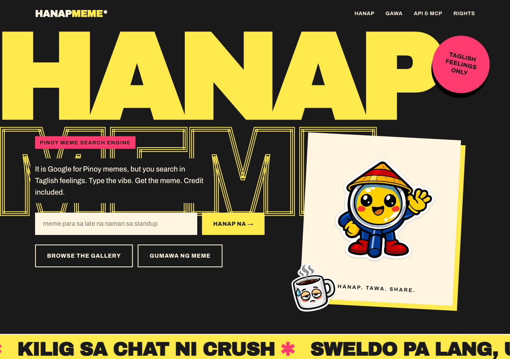
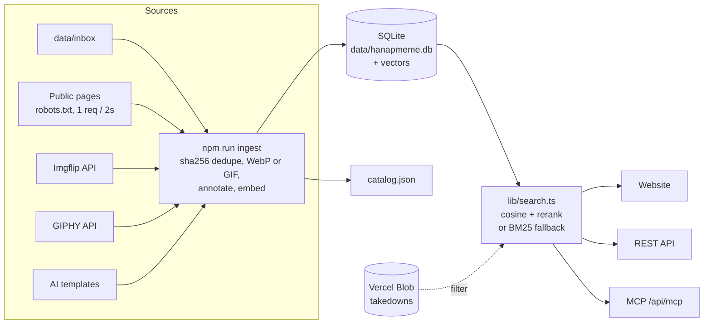

# HanapMeme

[](https://github.com/ahleksu/hanap-meme/actions/workflows/ci.yml)

It is Google for Pinoy memes, but you search in Taglish feelings.

Live: https://hanap-meme.vercel.app · MCP: `https://hanap-meme.vercel.app/api/mcp`

Type `meme para sa late na naman sa standup` and get matching memes and GIFs with source credit. There are three ways in:

1. A website with search, a gallery, and a meme generator.
2. A REST API.
3. An MCP server (Streamable HTTP), so Codex, ChatGPT, or Claude can search and make memes in a conversation.



## Quickstart (5 min)

You need Node 24 (LTS, see `.nvmrc`), npm, and your own OpenAI API key.

```bash
git clone https://github.com/ahleksu/hanap-meme.git
cd hanap-meme
npm i
cp .env.example .env.local          # then put your OPENAI_API_KEY in .env.local
cp sources.example.yaml sources.yaml
npm run ingest -- --limit 30        # builds your own meme library (about 15 min)
npm run templates                   # skips the 8 AI templates that are already in the repo
npm run dev
```

Open http://localhost:3000.

## Works without an API key

If `OPENAI_API_KEY` is not set, the app still runs:

- Search uses BM25 keyword scoring (a standard text-ranking formula) with a Taglish synonym map. For example, `pagod` also matches `tired`, `antok`, and `monday`.
- Ingest stores Imgflip templates, inbox images, and the AI templates with their names as descriptions. It skips scraped pages and GIPHY, because those images need an AI safety review before the app can show them.
- The generator uses the keyword-matched template and a plain caption.

A fresh clone with no library shows the empty state: "Wala pang memes. Run `npm run ingest` or drop images into data/inbox/."

## Assets and rights

The code is MIT. Scraped images are not in this repository, and the MIT license does not cover them. Each teammate builds a local library with `npm run ingest`. `catalog.json` holds the provenance of the maintainer's library: source URL, platform, author, and retrieval date. It holds no image bytes. The 8 AI templates in `public/templates/` and the stickers in `public/brand/` are original AI images and are in the repository. Removal requests are honored within 48 hours. Read [ASSET_LICENSE.md](ASSET_LICENSE.md) for the full terms.

Safety rules in the code:

- The AI review flags possible minors, private individuals, explicit content, and hateful content. A flagged image gets status `excluded` and is never served.
- Report sets status `takedown` at once. Only `active` memes leave the server, in the UI, the REST API, and MCP.
- Images are served by `/api/memes/:id/image`, which checks the status first. They are not in `public/`, so nobody can fetch a removed image by its file URL.
- The scraper obeys `robots.txt`, sends at most 1 request every 2 seconds per host, and identifies itself as `HanapMemeBot/0.1 (+<contact_url>)`.

## Architecture



| Path | What it holds |
| --- | --- |
| `app/` | Pages (`/`, `/search`, `/generate`, `/about`, `/takedown`) and API routes |
| `app/api/` | `search`, `memes/[id]`, `memes/[id]/image`, `report`, `generate`, `mcp` |
| `components/` | Client components: search, gallery, modal, toast |
| `lib/db.ts` | SQLite access. Every read filters to `active` |
| `lib/search.ts` | Embedding search, rerank, keyword fallback, synonym map |
| `lib/annotate.ts` | Image annotation with structured output |
| `lib/generate.ts` | Captions and meme rendering with `@napi-rs/canvas` |
| `lib/mcp.ts` | MCP tools |
| `lib/takedowns.ts` | Vercel Blob store for takedowns on a deploy |
| `scripts/` | `ingest`, `generate-templates`, `generate-brand`, `catalog` |
| `data/` | Local database and images (gitignored) |

## How OpenAI is used

| Job | Model | Where |
| --- | --- | --- |
| Annotate each image (Taglish and English description, text in the image, tags, format, safety flags) | `gpt-6.1-sol`, image input, structured output, reasoning effort `low` | `lib/annotate.ts`, run by `npm run ingest` |
| Embed descriptions and queries | `text-embedding-3-small` (1536 dimensions) | `lib/openai.ts` |
| Rerank the top 30 results (3 s timeout) | `gpt-6.1-sol`, structured output `{ids[]}` | `lib/search.ts` |
| Pick a template and write captions | `gpt-6.1-sol`, structured output | `lib/generate.ts` |
| Template backgrounds | `gpt-image-2` | `npm run templates` |
| Landing page stickers | `gpt-image-1.5` | `scripts/generate-brand.ts` |

Model substitution: `gpt-image-2` does not accept `background: "transparent"`, so the three transparent landing stickers use `gpt-image-1.5`. All other model IDs match the spec. You can override each model with `OPENAI_TEXT_MODEL`, `OPENAI_EMBED_MODEL`, and `OPENAI_IMAGE_MODEL`.

Every AI call has a timeout and a fallback. If a call fails, search falls back to cosine order or keyword search, and the generator falls back to a plain caption.

Rough cost for 30 images: annotation uses about 1,500 input tokens and 400 output tokens per image at $2 and $10 per 1M tokens, so about $0.21. Embeddings cost less than $0.01. The 8 templates are a one-time cost of a few cents each.

## REST API

| Method | Path | Notes |
| --- | --- | --- |
| GET | `/api/search?q=&limit=12` | `mode` is `semantic+rerank`, `semantic`, or `keyword`. Limit 1 to 50. |
| GET | `/api/memes/:id` | Metadata and provenance |
| GET | `/api/memes/:id/image` | WebP or GIF bytes |
| POST | `/api/report` | Body `{id, reason}`. Sets status `takedown` at once. |
| POST | `/api/generate` | Body `{situation, templateId?}`. Returns a PNG. Captions are in the `X-Caption-Top` and `X-Caption-Bottom` headers. |

CORS is open for GET only. Each route has a rate limit per IP.

## MCP

The server is at `/api/mcp` (stateless Streamable HTTP). It has three tools:

- `search_memes {query, limit?}` returns, for each result, a text block with id, description, source credit, and rights status, and a WebP thumbnail of 512 px or less.
- `get_meme {id}` returns the full image and provenance.
- `generate_meme {situation}` returns the PNG and the caption text.

Results for scraped items include `Rights unverified. Source: <url> · Report: <site>/takedown?id=<id>`.

Connect Codex:

```bash
codex mcp add hanapmeme --url http://localhost:3000/api/mcp
```

Test with the MCP Inspector:

```bash
npx @modelcontextprotocol/inspector
# Transport: Streamable HTTP, URL: http://localhost:3000/api/mcp
```

## Deploy to Vercel

The deploy bundles your local `data/hanapmeme.db` and `data/memes/` (read-only). Takedowns on the live site go to a private Vercel Blob store, so a reported meme stays hidden after a cold start.

```bash
npx vercel link
npx vercel blob create-store hanapmeme-takedowns --access private --yes
npx vercel env add OPENAI_API_KEY production
npx vercel deploy --prod
```

`.vercelignore` keeps `.env*`, `data/inbox/`, and `sources.yaml` out of the upload.

Production deploys come from the CLI only. `vercel.json` turns off automatic deploys from `main`, because a Git build has no meme library and would replace the live site with an empty one. Pull request previews still deploy, and they show the empty state.

If the Blob store is missing on a deploy, `POST /api/report` returns 503 and saves nothing. It never claims that it removed an image when it did not.

## Demo script

1. Open `/search` and type `late na naman sa standup`.
2. In Codex, after `codex mcp add`, ask: "Kuya, bigyan mo ako ng meme para sa standup na late na naman ako". Codex calls `search_memes` and shows the same memes with credit.
3. Click Report on one meme. Search again on the site, with `curl /api/search`, and in Codex. The meme is gone in all three.

## Optional sources

- `data/inbox/` takes your own images. A sidecar `<name>.json` can set `source_url`, `original_author`, `rights_status` (`own` or `unverified`), and descriptions.
- GIPHY: set `GIPHY_API_KEY` in `.env.local` (free key at developers.giphy.com). Ingest then searches the `giphy.queries` list in `sources.yaml` and keeps GIFs animated.

## Defaults chosen during the build

- Images are stored in `data/memes/` and served through an API route, not from `public/memes/`. The route checks the status, so removed images cannot leak by URL.
- Scraped page and GIPHY images are stored only after an AI safety review. With no key, ingest skips them.
- Imgflip and inbox images with no key get no safety flags. Use the Report button to remove a bad one.
- Ingest never re-activates an `excluded` or `takedown` meme, except through `approve: true` (see below).
- The maintainer can set `approve: true` on a link in `sources.yaml` or in an inbox sidecar. Approval lifts only the `possible_minor` and `private_individual` flags, never `explicit` or `hateful`, and never a takedown. Ingest logs each override. Read AGENTS.md for the rule.
- Report has no login, by design: anyone can hide a meme at once. The rate limit uses `x-vercel-forwarded-for` on Vercel. On other hosts, put the app behind a proxy that sets `X-Forwarded-For`.
- `catalog.json` lists active memes only.
- The rate limit is in memory per server process.
- The site uses one dark theme.

## Troubleshooting

| Problem | Fix |
| --- | --- |
| The search page shows "Wala pang memes" | Run `npm run ingest -- --limit 30`. |
| Search mode is always `keyword` | Make sure that `OPENAI_API_KEY` is in `.env.local`, then restart `npm run dev`. Memes ingested with no key have no embeddings, so run ingest again with the key. |
| `robots.txt disallows` in the ingest log | The site does not allow bots on that path. Remove it from `sources.yaml`. |
| `npm ci` warns about install scripts | Run `npm install-scripts ls`. `better-sqlite3` and `esbuild` are approved in `package.json`. |
| Ingest is slow | Each annotation is one reasoning call of 20 to 40 seconds. Use `--limit` to cap a run. Runs are resumable. |

## Credits

Built at DevDay Exchange Community: Manila, Nov 6, 2026. Anton font by The Anton Project Authors (SIL OFL 1.1). Templates from the Imgflip API. GIFs powered by GIPHY when enabled.
